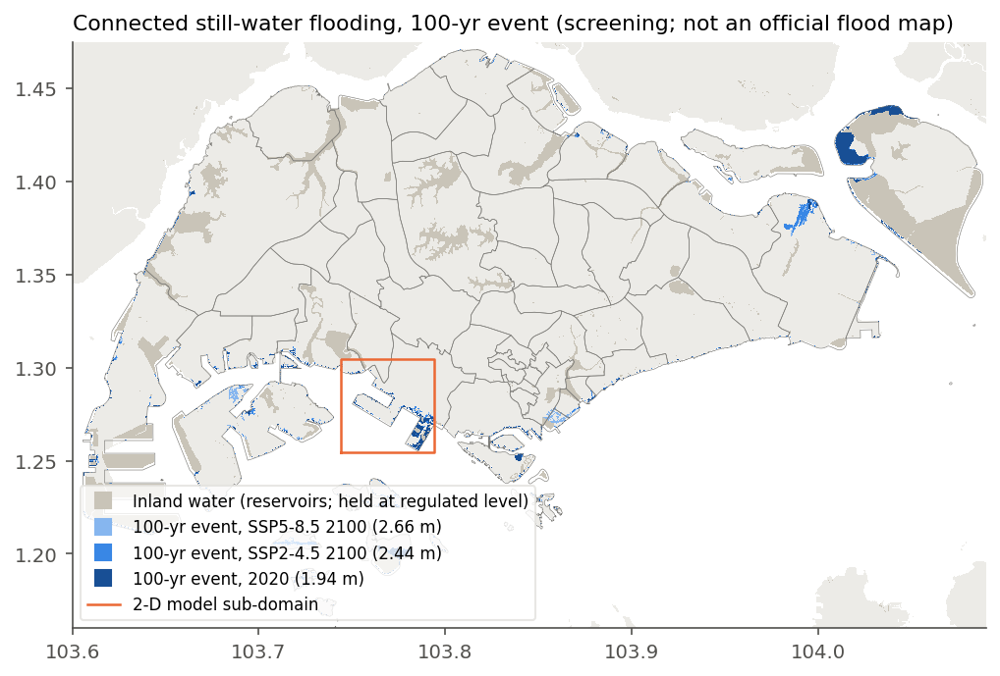
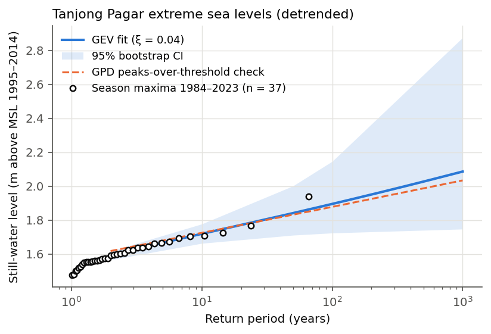
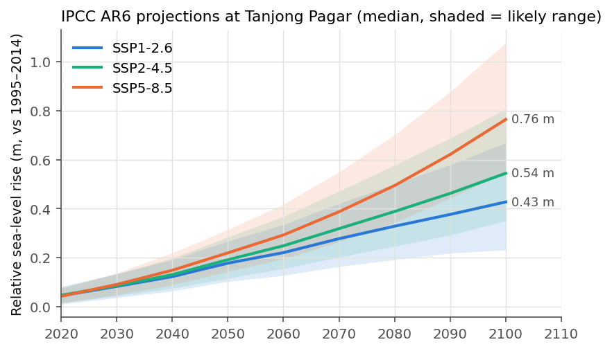
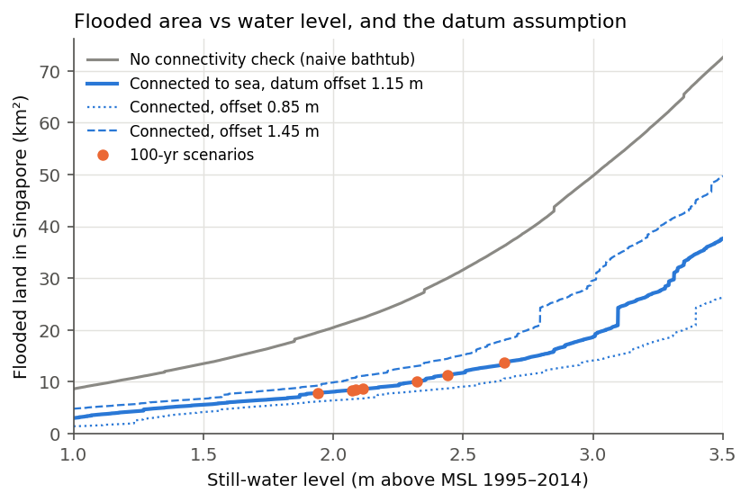
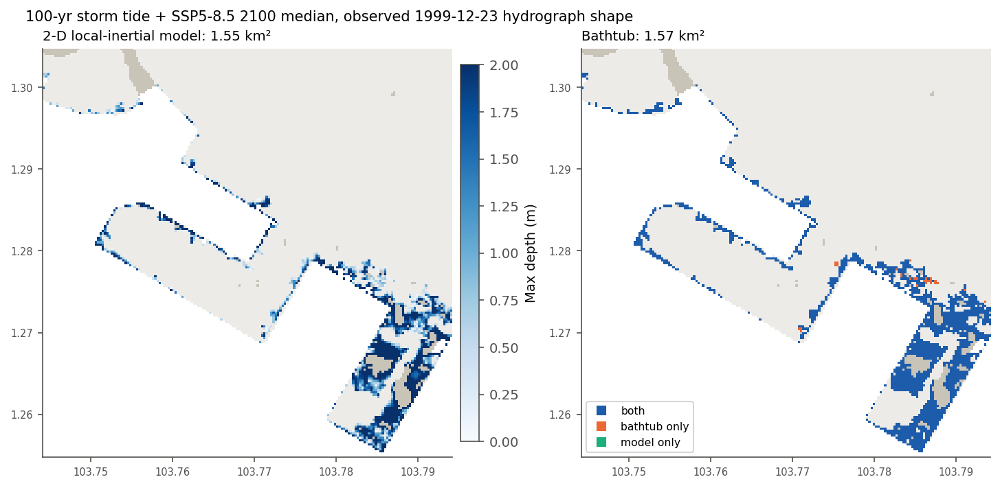

# sg-coastal-inundation

Screening-level coastal flood exposure for Singapore under extreme sea levels and IPCC AR6
sea-level rise: tide-gauge extreme value analysis, AR6 projections, a hydraulically connected
"bathtub" on an open 30 m DEM, a 2-D local-inertial storm-tide model for one sub-domain, and
exposure of buildings, roads, MRT stations and residents, published as an interactive map.

**Live map:** https://luoaini1213.github.io/sg-coastal-inundation/ ·
**Technical report:** [report/report.pdf](report/report.pdf)

> **Not an official flood map.** Independent personal project by Wenjie Luo; not affiliated with,
> reviewed or endorsed by NUS, TMSI, PUB or any agency. It ignores coastal defences, drainage,
> waves and rainfall, and runs on a global surface model with metre-level vertical error. Use
> it to understand the method and the sensitivities, not to judge any site.



## Headline results

| 100-year still-water event | Water level (m above MSL 1995–2014) | Flooded land (km²) [AR6 likely range] | of which mainland (km²) | Buildings within ~60 m | Residents (proxy) | Roads (km) | MRT stations |
|---|---|---|---|---|---|---|---|
| 2020 sea level | {{wl_100_2020}} | {{area_100_2020}} | {{main_100_2020}} | {{bldg_100_2020}} | {{pop_100_2020}} | {{road_100_2020}} | {{mrt_100_2020}} |
| SSP2-4.5, 2050 | {{wl_100_ssp245_2050}} | {{area_100_ssp245_2050}} [{{area_100_ssp245_2050_lo}}–{{area_100_ssp245_2050_hi}}] | {{main_100_ssp245_2050}} | {{bldg_100_ssp245_2050}} | {{pop_100_ssp245_2050}} | {{road_100_ssp245_2050}} | {{mrt_100_ssp245_2050}} |
| SSP1-2.6, 2100 | {{wl_100_ssp126_2100}} | {{area_100_ssp126_2100}} [{{area_100_ssp126_2100_lo}}–{{area_100_ssp126_2100_hi}}] | {{main_100_ssp126_2100}} | {{bldg_100_ssp126_2100}} | {{pop_100_ssp126_2100}} | {{road_100_ssp126_2100}} | {{mrt_100_ssp126_2100}} |
| SSP2-4.5, 2100 | {{wl_100_ssp245_2100}} | {{area_100_ssp245_2100}} [{{area_100_ssp245_2100_lo}}–{{area_100_ssp245_2100_hi}}] | {{main_100_ssp245_2100}} | {{bldg_100_ssp245_2100}} | {{pop_100_ssp245_2100}} | {{road_100_ssp245_2100}} | {{mrt_100_ssp245_2100}} |
| SSP5-8.5, 2100 | {{wl_100_ssp585_2100}} | {{area_100_ssp585_2100}} [{{area_100_ssp585_2100_lo}}–{{area_100_ssp585_2100_hi}}] | {{main_100_ssp585_2100}} | {{bldg_100_ssp585_2100}} | {{pop_100_ssp585_2100}} | {{road_100_ssp585_2100}} | {{mrt_100_ssp585_2100}} |

All 14 scenarios (10- and 100-year events × 2020 / 3 SSPs × 2050 / 2100) are in
[outputs/exposure_scenarios.csv](outputs/exposure_scenarios.csv) and per planning area in
[outputs/exposure_by_planning_area.csv](outputs/exposure_by_planning_area.csv).

What the numbers say, plainly:

* **About half of the flooded area is on offshore islands and recent reclamation**, not on the
  populated mainland: for the 100-yr SSP5-8.5 2100 case {{island_share}} of the flooded area is in
  the three island planning areas, and the largest planning-area totals are {{top_pa}}.
  Residents near flooded cells number in the low thousands, because Singapore's mainland
  coast sits on raised reclamation platforms (the DSM also biases ground upward; see limitations).
* **Hydraulic connectivity matters:** a naive "everything below the water level" bathtub gives
  {{naive_100_ssp585_2100}} km² for the same case, {{naive_ratio}}× the connected result.
* **The vertical datum is the dominant uncertainty.** Shifting the DEM-to-MSL offset by ±0.3 m moves the
  2100 SSP5-8.5 100-yr area from {{dlo_100_ssp585_2100}} to {{dhi_100_ssp585_2100}} km²; ignoring the
  offset altogether (treating the EGM2008 geoid as mean sea level) gives {{d0_100_ssp585_2100}} km².
* **Event duration matters little at the modelled site:** in the 2-D sub-domain a realistic
  72-hour storm-tide hydrograph floods {{m_ratio}} of the bathtub extent (see §4).

## Method

### 1. Extreme sea levels — Tanjong Pagar tide gauge

* UHSLC research-quality hourly record, station 699 (Tanjong Pagar, GLOSS 044),
  {{n_hours}} valid hours, 1984–2023, metres above the gauge's chart datum.
* **Datum:** everything is referenced to the 1995–2014 mean sea level (the AR6 baseline),
  which is {{msl_cd}} m above the gauge chart datum (mean of the annual means of years with
  ≥80 % data). No benchmark or Singapore Height Datum conversion is used or needed for the
  extremes.
* **Detrending:** a linear trend fitted to the annual means ({{trend}} ± {{trend_se}} mm/yr, OLS
  standard error, no autocorrelation correction) is removed, anchored at 2005 (the middle of
  1995–2014). Sanity check: the trend implies {{obs_rise_2020}} cm of rise from 2005 to 2020; AR6
  gives {{ar6_2020}} cm for 2020 relative to 1995–2014.
* **Block maxima:** July–June "season" maxima, because {{share_ne_monsoon}} of the maxima fall in the
  Northeast Monsoon (Nov–Feb) and calendar years would split that season. Seasons with <80 %
  hourly coverage are dropped, leaving {{n_seasons}}. Largest: {{max_obs}} m on {{max_obs_date}}.
* **GEV** by maximum likelihood (own likelihood, cross-checked against `scipy` in tests):
  μ = {{gev_mu}}, σ = {{gev_sigma}}, ξ = {{gev_xi}} (95 % bootstrap {{xi_lo}} to {{xi_hi}}; a likelihood-ratio
  test cannot reject Gumbel, p = {{gumbel_p}}). Return levels with 95 % non-parametric bootstrap
  intervals (1,000 resamples):

  | Return period | Level (m above MSL 1995–2014) | 95 % CI |
  |---|---|---|
  | 10 yr | {{rl10}} | {{rl10_lo}}–{{rl10_hi}} |
  | 100 yr | {{rl100}} | {{rl100_lo}}–{{rl100_hi}} |
  | 1,000 yr | {{rl1000}} | {{rl1000_lo}}–{{rl1000_hi}} |

* **Cross-checks:** peaks-over-threshold with a GPD (99.9th-percentile threshold, 72 h runs
  declustering, {{gpd_n}} clusters, {{gpd_rate}} per year) gives a 100-yr level of {{rl100_gpd}} m;
  removing each year's own mean instead of a linear trend gives {{rl100_am}} m (CI upper bound
  {{rl100_am_hi}} m).



### 2. Sea-level rise — IPCC AR6

Total relative sea-level change (including vertical land motion), medium-confidence workflow,
at the AR6 location for Tanjong Pagar (PSMSL 1746), relative to 1995–2014. The file is pulled
out of the 9 GB Zenodo archive with HTTP range requests (only the ~72 MB per scenario is read).

| Scenario | 2050 median [likely] (m) | 2100 median [likely] (m) |
|---|---|---|
| SSP1-2.6 | {{slr_ssp126_2050}} [{{slr_ssp126_2050_lo}}–{{slr_ssp126_2050_hi}}] | {{slr_ssp126_2100}} [{{slr_ssp126_2100_lo}}–{{slr_ssp126_2100_hi}}] |
| SSP2-4.5 | {{slr_ssp245_2050}} [{{slr_ssp245_2050_lo}}–{{slr_ssp245_2050_hi}}] | {{slr_ssp245_2100}} [{{slr_ssp245_2100_lo}}–{{slr_ssp245_2100_hi}}] |
| SSP5-8.5 | {{slr_ssp585_2050}} [{{slr_ssp585_2050_lo}}–{{slr_ssp585_2050_hi}}] | {{slr_ssp585_2100}} [{{slr_ssp585_2100_lo}}–{{slr_ssp585_2100_hi}}] |

Scenario still-water level = GEV return level + AR6 median (likely-range bounds give the
bracketed areas). The 17th/83rd percentiles are AR6's "likely" range; AR6's low-confidence
high-end ice-sheet storyline is **not** included, so these are not worst cases. (Official
Singapore planning figures cite up to 1.15 m of mean-sea-level rise by 2100 and higher combined
extremes; this study does not reproduce those.)



### 3. Inundation — connected bathtub on Copernicus GLO-30

* DEM: Copernicus GLO-30 (two 1° tiles, 1 arc-second ≈ {{cell_size}} m), heights above the EGM2008
  geoid. It is a **surface** model: roofs and tree canopy are included.
* **Geoid → local MSL:** mean sea level is not the geoid. The offset (mean dynamic topography)
  from DTU22MDT around Singapore is {{mdt}} m, so z_MSL = z_EGM2008 − {{mdt}} m. As a plausibility
  check, with the offset {{below5_mdt}} of Singapore's land is < 5 m above MSL, vs {{below5_raw}} without
  it; the government figure is "around 30 %" (NCCS), and a surface model should under-count low
  ground, so the offset moves the DEM in the right direction. This is still the most uncertain
  input; results are shown for ±0.3 m and for no offset.
* **Sea vs inland water:** GLO-30 flattens water to 0 m. Zero cells connected to the raster edge
  and outside the URA land polygons are open sea. Zero cells inside the land polygons
  (Marina, Pandan and other barrage reservoirs, ponds) and any exactly flat patch ≥ 300 cells
  (other reservoirs, flattened to a single height) are inland water, held at their regulated
  level: they neither flood nor convey seawater. Without this rule Marina Reservoir counted as
  open sea and flooded Kallang at present-day 10-yr levels.
* **Connectivity:** a land cell floods at still-water level *h* only if a path of cells all
  below *h* links it to the open sea (4-connected). Instead of one flood fill per scenario,
  a priority flood computes each cell's *fill level* (the minimax path height) once; then
  flooded(h) = fill < h for any h. Tests check it cell-for-cell against connected-component
  labelling. 8-connectivity raises the 2100 SSP5-8.5 100-yr area to {{e8_100_ssp585_2100}} km².



### 4. A genuine numerical model: 2-D local-inertial storm tide

`src/sgci/inertial.py` solves the local-inertial shallow-water equations (Bates et al. 2010;
de Almeida et al. 2012): face discharges with semi-implicit Manning friction, cell-centred
depths, CFL-limited time step, prescribed water level in sea cells, walls at inland water.

* **Verification:** against the analytical moving-front solution (Hunter et al. 2005) at
  n = 0.03 the depth RMSE is {{hunter_rmse}} cm ({{hunter_rel}} of the maximum depth); a lake at rest
  stays at rest to 1e-9 m; volume is conserved (largest relative mass error in the runs
  below {{m_mass}}).
* **Experiment:** a 180 × 180-cell mainland sub-domain ({{m_box}}) centred on the densest
  bathtub flooding, forced by the observed 1999-12-23 storm-tide hydrograph (±36 h, detrended)
  raised so that its peak equals the 100-yr SSP5-8.5 2100 level ({{wl_100_ssp585_2100}} m).
  Cells count as flooded at ≥ 5 cm maximum depth.

| Run | Flooded (km²) |
|---|---|
| Bathtub, same sub-domain | {{m_bath}} |
| 2-D model, base (n = 0.035, 30 m, α = 0.7) | {{m_base}} |
| Peak level held constant (bathtub assumption) | {{m_steady}} |
| Half time step (α = 0.35) | {{m_alpha_0.35}} |
| n = 0.02 / n = 0.06 | {{m_n_0.02}} / {{m_n_0.06}} |
| 60 m / 90 m grid | {{m_dx_60}} / {{m_dx_90}} |

The model floods {{m_ratio}} of the bathtub area; holding the peak level constant gives
{{m_steady_ratio}}, i.e. the model reproduces the bathtub when the bathtub's own assumption is imposed,
and the {{m_reduction}} gap is the effect of finite event duration. Halving the time step changes the
area by {{m_alpha_diff}}; tripling the cell size changes it by {{m_dx90_diff}}. Conclusion for this site:
the low ground is close to the shore and fills within one high tide, so the bathtub is only
mildly conservative here — that is a site result, not a general one.



### 5. Exposure

* Buildings: {{n_buildings}} OSM building centroids. Because the DSM records roof height at the
  building itself, a building counts as exposed if a flooded cell lies within 2 cells (~60 m).
* Residents (proxy): Census 2020 population per subzone × share of that subzone's buildings
  that are exposed. This assumes residents are spread evenly over buildings; it is a proxy.
* Roads: OSM drivable road centrelines ({{road_km_total}} km in Singapore), sampled every ~10 m;
  a sample counts if its own cell floods (elevated expressways correctly stay dry).
* MRT: LTA station exits ({{n_exits}} exits, {{n_stations}} station names); a station counts if any exit is
  within ~60 m of flooding. For 100-yr SSP5-8.5 2100: {{mrt_names_100_ssp585_2100}}.

## Limitations (read before quoting any number)

1. **DEM:** Copernicus GLO-30 is a radar surface model (TanDEM-X, acquired 2011–2015) with
   metre-level vertical error in built-up and vegetated areas; buildings and canopy make ground
   look higher (flooding under-estimated), while radar noise on flat terminals and reclaimed
   land can make it look lower. Land reclaimed after acquisition (Tuas, Pulau Tekong polder) is
   wrong or appears as water.
2. **Datum:** the {{mdt}} m geoid-to-MSL offset comes from a global altimetry MDT that is
   least reliable at the coast; ±0.3 m changes the headline area by tens of percent.
3. **Not modelled:** sea walls, revetments, tidal gates, pumps and drains; waves and wave
   set-up; rainfall and river flow (compound flooding); land subsidence beyond AR6's VLM term.
4. **Statistics:** {{n_seasons}} seasons support a 100-yr estimate with a wide interval; the 1,000-yr
   value is shown only to illustrate that width. Extremes are assumed stationary apart from
   the mean-sea-level shift.
5. **Exposure:** OSM completeness varies; residents are a building-weighted proxy; a "building
   within ~60 m" is not a flooded building.
6. **2-D model:** one sub-domain, one hydrograph shape, uniform roughness, no infiltration.

## Reproduce

```bash
pip install -r requirements.txt
python scripts/run_pipeline.py        # downloads ~350 MB into data_cache/ (git-ignored), ~40 min CPU
python scripts/make_figures.py
python tools/check_readme_numbers.py --write
```

Checks (all run in CI on committed outputs, no downloads):

```bash
python -m pytest -q                    # unit tests + output consistency
python tools/check_readme_numbers.py   # every README number recomputed from outputs/
python tools/mutation_check.py         # planted bugs must each fail a test
```

## Data sources and licences

| Data | Source | Licence / terms |
|---|---|---|
| Hourly sea level, Tanjong Pagar (UHSLC 699) | University of Hawaii Sea Level Center, research-quality data | Freely available; cite Caldwell, Merrifield & Thompson (2015), NOAA NCEI accession 0019568 |
| AR6 regional sea-level projections | Garner et al. (2021), Zenodo 10.5281/zenodo.6382554; Fox-Kemper et al. (2021) | CC BY 4.0 |
| Copernicus GLO-30 DEM | ESA / Copernicus, via AWS Open Data (`copernicus-dem-30m`) | Free use incl. redistribution of derived products with attribution: © DLR e.V. 2010–2014 and © Airbus Defence and Space GmbH 2014–2018, provided under COPERNICUS by the EU and ESA |
| DTU22MDT mean dynamic topography | DTU Space, ftp.space.dtu.dk/pub/DTU22/MDT | Open download; cite Knudsen et al. (DTU22MDT) |
| Planning areas, subzones (MP2019, no sea) | URA via data.gov.sg | Singapore Open Data Licence v1.0 |
| Resident population by subzone (Census 2020) | SingStat via data.gov.sg | Singapore Open Data Licence v1.0 |
| MRT station exits | LTA via data.gov.sg | Singapore Open Data Licence v1.0 |
| Buildings, roads | © OpenStreetMap contributors, Overpass API | ODbL 1.0 (derived counts and the flood layer are published with attribution) |
| Basemap (web map) | OpenFreeMap / OpenMapTiles, © OpenStreetMap contributors | Free, no key |

No dataset needed an account or API key. Raw downloads are cached in `data_cache/` and not
committed; only small derived outputs are.

## Repository layout

```
src/sgci/        fetch, tide, eva (GEV/GPD), slr (AR6), dem (datum), inundation, inertial, exposure
scripts/         run_pipeline.py, run_model.py, make_figures.py, build_report.py
outputs/         derived tables, JSON and figures (committed)
docs/            GitHub Pages web map (MapLibre GL) and its data
report/          technical report (Markdown source and PDF)
tests/, tools/   unit tests, README-number check, mutation check
```

MIT licence (code). Data remain under their own licences above.
