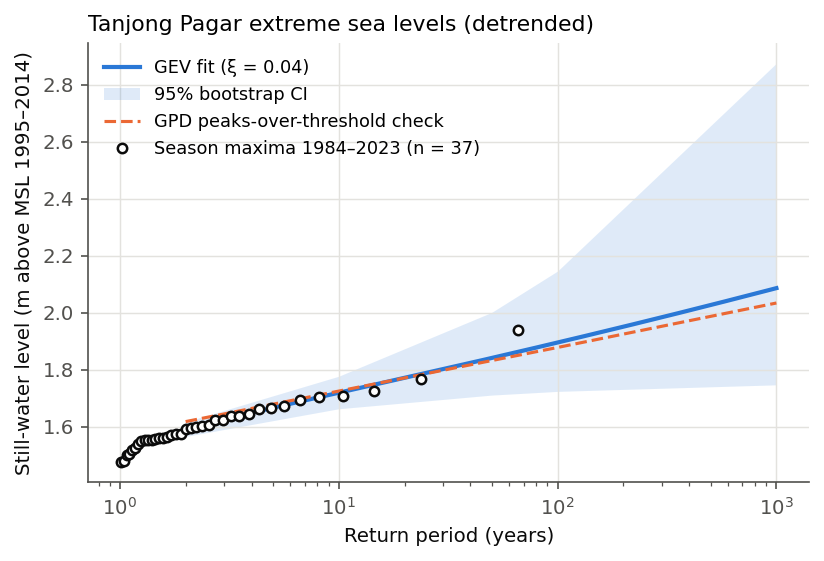
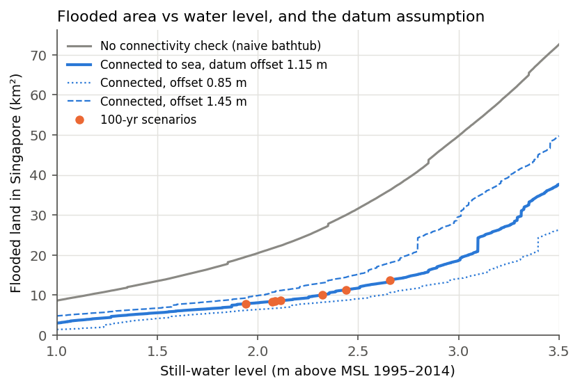
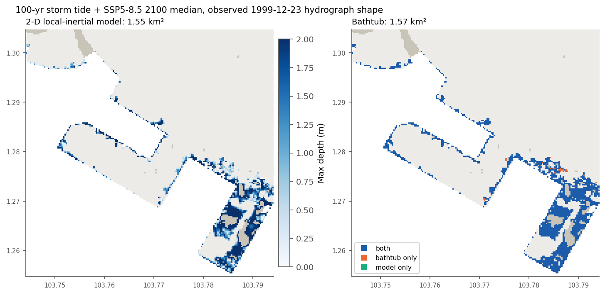

# Summary

This report estimates which parts of Singapore would be below, and hydraulically connected
to, extreme still-water sea levels today and under IPCC AR6 sea-level rise, and what lies
there. It is a screening exercise built entirely on open data; it is **not an official flood
map**. Coastal defences, drainage, waves and rainfall are not represented.

* The 100-year still-water level at Tanjong Pagar is 1.90 m above the 1995–2014 mean sea level
  (95 % CI 1.72–2.15 m), from a GEV fit to 37 detrended monsoon-season maxima.
* Adding AR6 medium-confidence projections gives 100-year levels of 1.94 m (2020) to
  2.66 m (SSP5-8.5, 2100).
* Connected flooding grows from 7.9 km² to 13.7 km² (AR6 likely range
  11.4–18.3 km²) across those cases; 53% of the 2100 SSP5-8.5 area is on
  offshore islands. Exposure is small: 1,558 buildings within ~60 m of
  flooding and a building-weighted proxy of 3,460 residents.
* The dominant uncertainty is vertical: a ±0.3 m change in the geoid-to-MSL offset moves the
  2100 SSP5-8.5 area between 10.6 and 18.1 km²; ignoring the offset gives
  5.6 km². Hydraulic connectivity also matters: the naive bathtub gives 36.3 km².
* A 2-D local-inertial model of one mainland sub-domain, verified against an analytical
  solution (RMSE 8.0 cm), floods 98% of the bathtub area under a realistic 72-hour
  storm-tide hydrograph, and 100% when the peak is held constant.

# 1. Data

| Input | Source | Notes |
|---|---|---|
| Hourly sea level | UHSLC station 699, Tanjong Pagar, 1984–2023 | 338,246 valid hours, chart datum |
| Sea-level projections | IPCC AR6 (Garner et al. 2021), PSMSL 1746 | total RSL incl. VLM, medium confidence |
| Elevation | Copernicus GLO-30 DSM | 1″ (~31 m), EGM2008 heights |
| Geoid-to-MSL offset | DTU22MDT | 1.15 m mean over Singapore Strait cells |
| Boundaries, population | URA MP2019 planning areas and subzones; SingStat Census 2020 | data.gov.sg |
| Assets | OSM buildings (126,346) and roads (10,108 km); LTA MRT exits (613) | |

# 2. Methods

**Reference level.** All water levels are metres above the 1995–2014 mean sea level, which is
1.71 m above the Tanjong Pagar chart datum and is also the AR6 baseline, so return levels and
projections add directly.

**Extremes.** The hourly record is detrended by the linear trend of annual means
(3.1 ± 0.5 mm/yr) anchored at 2005. Maxima are taken per July–June season
(81% fall in November–February); seasons with less than 80 % data are dropped. A GEV
is fitted by maximum likelihood (μ = 1.566, σ = 0.065, ξ = 0.04; bootstrap 95 % range of ξ
-0.35 to 0.28; Gumbel not rejected, p = 0.70). Return-level intervals come from 1,000
non-parametric bootstrap resamples. Two cross-checks fall inside the interval: a GPD on
declustered exceedances of the 99.9th percentile (124 clusters) gives 1.88 m for 100 years,
and removing each year's mean instead of a trend gives 1.92 m.

| Return period | Level (m) | 95 % CI (m) |
|---|---|---|
| 10 yr | 1.72 | 1.66–1.78 |
| 100 yr | 1.90 | 1.72–2.15 |
| 1,000 yr | 2.09 | 1.75–2.88 |

{width=78%}

**Sea-level rise.** AR6 medians and likely ranges (17th–83rd percentiles) at Tanjong Pagar:

| Scenario | 2050 (m) | 2100 (m) |
|---|---|---|
| SSP1-2.6 | 0.18 [0.10–0.27] | 0.43 [0.23–0.67] |
| SSP2-4.5 | 0.19 [0.12–0.28] | 0.54 [0.35–0.81] |
| SSP5-8.5 | 0.22 [0.14–0.31] | 0.76 [0.55–1.08] |

The observed trend implies 4.7 cm of rise from 2005 to 2020, consistent with the AR6
value of 4.6 cm for 2020. The AR6 low-confidence high-end storyline is not included.

**Vertical datum.** Copernicus heights refer to the EGM2008 geoid, but local mean sea level
lies above the geoid by the mean dynamic topography. Heights are converted with
z_MSL = z_EGM2008 − 1.15 m (DTU22MDT). With the offset, 20% of the land is below 5 m above MSL,
against 13% without it; the official figure is about 30 %, and a surface model should
under-count low ground, so the offset is directionally supported but not validated.

**Connected inundation.** Water cells in GLO-30 are flattened to 0 m. Zero cells linked to the
raster edge and outside the land polygons are open sea; zero cells inside the land polygons and
exactly flat patches of ≥ 300 cells are regulated inland water (barrage reservoirs), which
neither flood nor convey water. A priority flood gives each land cell the minimum still-water
level at which it connects to the sea; a scenario floods all cells whose fill level is below
its water level.

**2-D model.** The local-inertial equations (Bates et al. 2010) are solved on the 30 m grid of a
180 × 180-cell mainland sub-domain (103.744–103.794°E, 1.255–1.305°N), forced at sea cells by the observed 1999-12-23
storm tide raised so its peak equals 2.66 m. Verification: analytical front test
(RMSE 8.0 cm, 3.4% of peak depth), lake-at-rest and mass-conservation tests (largest relative
mass error 7e-13).

**Exposure.** Buildings and MRT exits count if a flooded cell is within ~60 m (the DSM puts
roof heights at the building itself); roads count where their own cell floods; residents are
Census 2020 subzone populations scaled by the share of exposed buildings.

# 3. Results

| 100-yr event | Level (m) | Area (km²) [likely] | Mainland (km²) | Buildings | Residents (proxy) | Roads (km) |
|---|---|---|---|---|---|---|
| 2020 | 1.94 | 7.9 | 3.1 | 941 | 2,500 | 69 |
| SSP2-4.5 2050 | 2.09 | 8.5 [8.1–9.0] | 3.4 | 1,045 | 2,720 | 76 |
| SSP1-2.6 2100 | 2.32 | 10.0 [8.7–12.6] | 4.4 | 1,264 | 3,020 | 93 |
| SSP2-4.5 2100 | 2.44 | 11.3 [9.3–14.1] | 5.2 | 1,344 | 3,130 | 104 |
| SSP5-8.5 2100 | 2.66 | 13.7 [11.4–18.3] | 6.5 | 1,558 | 3,460 | 134 |

The largest planning-area totals for the 2100 SSP5-8.5 100-yr case are North-Eastern Islands (3.7 km²), Western Islands (3.2 km²), Queenstown (1.6 km²). MRT
stations with an exit within ~60 m of flooding in that case: Marina Bay, Marina South, Marina South Pier.

{width=78%}

| Sensitivity (100-yr, SSP5-8.5 2100) | Area (km²) |
|---|---|
| Central (offset 1.15 m, 4-connected) | 13.7 |
| Offset −0.3 m / +0.3 m | 10.6 / 18.1 |
| No offset (geoid = MSL) | 5.6 |
| 8-connected | 14.8 |
| No connectivity check | 36.3 |

**2-D model.** Bathtub 1.57 km²; model 1.55 km² (98%); peak held constant 1.57 km²
(100%). Halving the time step changes the area by 0.5%; averaging the DEM to 60 m / 90 m loses
20% / 37% of it (narrow low channels are smoothed away), so the result depends on the 30 m terrain;
Manning n from 0.02 to 0.06 gives 1.56 to 1.54 km².

{width=92%}

# 4. Limitations

1. GLO-30 is a radar surface model (2011–2015) with metre-level vertical error; buildings and
   canopy raise apparent ground; radar noise and post-acquisition reclamation distort the coast.
2. The geoid-to-MSL offset comes from a global MDT that is least reliable near coasts.
3. Defences, gates, pumps, drains, waves, rainfall and compound flooding are not modelled.
4. 37 seasons of data constrain a 100-yr level only loosely; stationarity of the surge
   climate is assumed.
5. Exposure counts are proximity-based proxies, not damage estimates.

# References

* Bates, P. D., Horritt, M. S. & Fewtrell, T. J. (2010). A simple inertial formulation of the shallow water equations for efficient two-dimensional flood inundation modelling. *J. Hydrol.* 387, 33–45.
* Barnes, R., Lehman, C. & Mulla, D. (2014). Priority-flood: an optimal depression-filling and watershed-labeling algorithm for digital elevation models. *Comput. Geosci.* 62, 117–127.
* Caldwell, P. C., Merrifield, M. A. & Thompson, P. R. (2015). Sea level measured by tide gauges from global oceans — the Joint Archive for Sea Level holdings. NOAA NCEI, accession 0019568.
* Coles, S. (2001). *An Introduction to Statistical Modeling of Extreme Values.* Springer.
* de Almeida, G. A. M., Bates, P., Freer, J. E. & Souvignet, M. (2012). Improving the stability of a simple formulation of the shallow water equations for 2-D flood modeling. *Water Resour. Res.* 48.
* Fox-Kemper, B. et al. (2021). Ocean, cryosphere and sea level change. In *Climate Change 2021: The Physical Science Basis*, IPCC AR6 WGI, ch. 9.
* Garner, G. G. et al. (2021). IPCC AR6 sea level projections. Zenodo, 10.5281/zenodo.6382554.
* Hunter, N. M., Horritt, M. S., Bates, P. D., Wilson, M. D. & Werner, M. G. F. (2005). An adaptive time step solution for raster-based storage cell modelling of floodplain inundation. *Adv. Water Resour.* 28, 975–991.
* Kulp, S. A. & Strauss, B. H. (2019). New elevation data triple estimates of global vulnerability to sea-level rise and coastal flooding. *Nat. Commun.* 10, 4844.
* DTU Space. DTU22MDT mean dynamic topography. ftp.space.dtu.dk/pub/DTU22/MDT.
